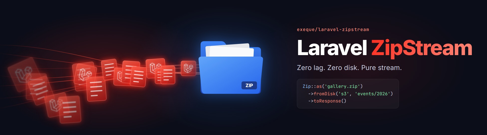

<p align="center"></p>

<p align="center">
<a href="https://packagist.org/packages/exeque/laravel-zipstream"></a>
<a href="https://packagist.org/packages/exeque/laravel-zipstream"></a>
<a href="https://github.com/ExeQue/laravel-zipstream/actions/workflows/tests.yml"></a>
<a href="https://github.com/ExeQue/laravel-zipstream/actions/workflows/docs.yml"></a>

<a href="LICENSE.md"></a>
</p>

# Laravel ZipStream

A fluent Laravel wrapper for [maennchen/zipstream-php](https://github.com/maennchen/zipstream-php) to easily generate and stream ZIP archives.

## Installation

```bash
composer require exeque/laravel-zipstream
```

The service provider registers itself. Upgrading from 0.x? See the [upgrade guide](UPGRADE.md).

Both of these are optional - the package works with its own defaults:

```bash
# Defaults for compression, progress reporting and size formatting
php artisan vendor:publish --tag="laravel-zipstream-config"

# The progress strings, shipped in 30 languages
php artisan vendor:publish --tag="laravel-zipstream-translations"
```

See [Configuration](docs/configuration.md) for what each key does.

## Basic Usage

```php
use ExeQue\ZipStream\Facades\Zip;

// Stream an archive to the browser
return Zip::as('gallery.zip')
    ->fromDisk('s3', 'events/2026/photo.jpg')
    ->fromLocalDirectory('/var/exports/2026', 'exports')
    ->fromRaw('README.txt', 'Thanks for downloading!')
    ->toResponse();

// Or build it straight to a disk, while it uploads
Zip::fromDiskDirectory('s3', 'events/2026', 'gala')
    ->saveToDisk('s3', 'archives/gala.zip');
```

Nothing is buffered: an archive of any size streams at constant memory, whether it goes to the browser, a disk or
a local path.

## Documentation

Documentation: [Here](https://exeque.github.io/laravel-zipstream/)

Upgrading from 0.x? See the [upgrade guide](UPGRADE.md).

## Testing

```bash
composer test
```

The S3 test for `saveToDisk()` is skipped unless an S3-compatible server is available. See
[Testing against S3 with MinIO](contributing/testing-with-minio.md) to run it locally.

## License

The MIT License (MIT). Please see [License File](LICENSE.md) for more information.
